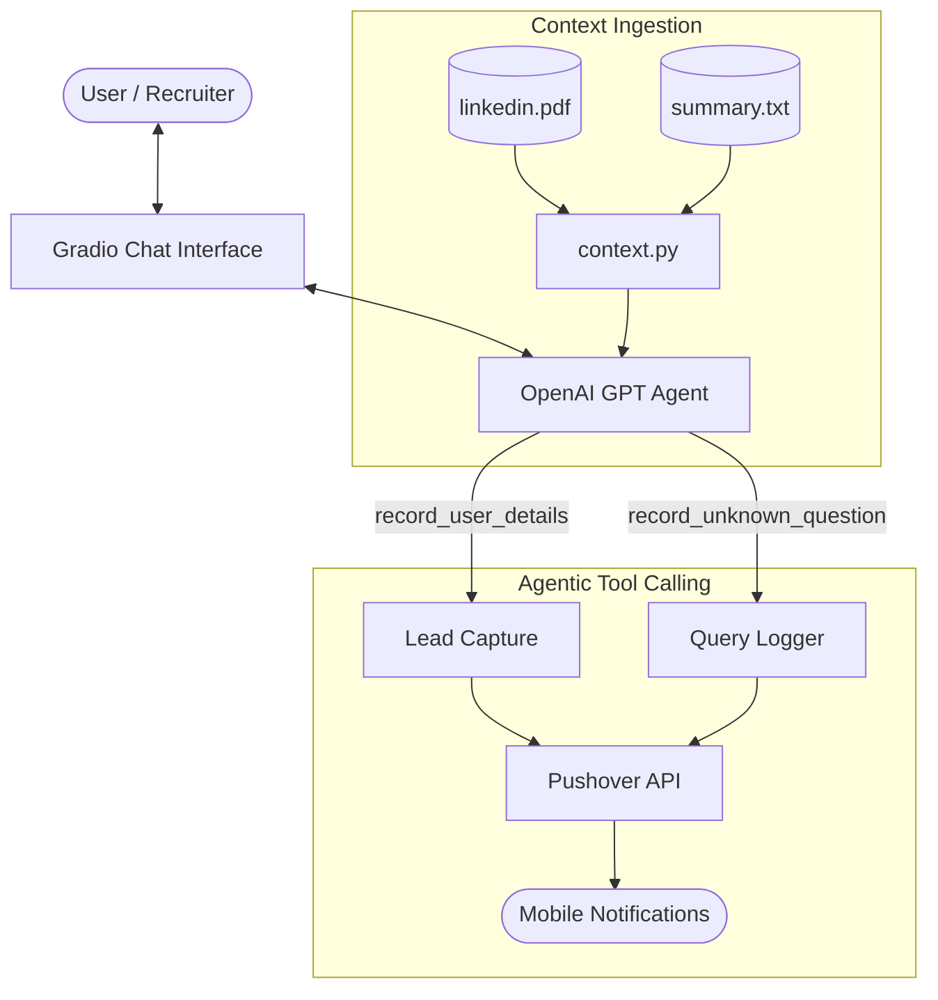

# 🤖 Resume Assistant & Digital Twin Agentic Chatbot

[](https://www.python.org/)
[](https://platform.openai.com/)
[](https://www.gradio.app/)
[](LICENSE)

An intelligent, interactive **Digital Twin & Resume Assistant** powered by OpenAI's GPT models and Gradio. This agent represents **Mohd Adeeb** (Software Engineer, Entrepreneur, and Data Scientist), engaging prospective employers, recruiters, and clients in real-time conversations about his professional background, technical stack, experience, and projects.

Equipped with **agentic tool calling**, the chatbot can autonomously capture recruiter contact info and log unanswered questions for real-time push notifications sent via **Pushover**.

---

## 🌟 Key Features

- **🧠 Personality & Career Grounding**: Automatically ingests and extracts context from `linkedin.pdf` (via `pypdf`) and combines it with personalized background notes in `summary.txt`.
- **🛠️ Agentic Tool Calling (Function Calling)**:
  - `record_user_details`: Autonomously captures visitor emails, names, and conversation notes when someone wishes to get in touch.
  - `record_unknown_question`: Logs unfamiliar or unanswered questions to prevent hallucinations and notify the author for review.
- **📱 Instant Mobile Alerts (Pushover)**: Delivers instant push notifications to mobile devices when a lead shares their contact info or an unknown question is logged.
- **🎨 Modern, Polished Gradio Interface**: Fully custom responsive UI with light/dark theme support, smooth typography, and pre-configured prompt suggestions.
- **🛡️ Strict Professional Guardrails**: Steers irrelevant conversations back to professional career topics and never hallucinates facts outside the verified resume context.

---

## 🏗️ Architecture & Workflow



---

## 🗂️ Project Structure

```text
.
├── app.py              # Main Gradio application entrypoint and agent loop
├── context.py          # PDF extraction and system prompt constructor
├── tools.py            # Agent tools definition (lead capture & question logger)
├── styles.py           # Custom CSS, JS, and example prompts for Gradio UI
├── requirements.txt    # Python dependencies
├── summary.txt         # Personal summary and biographical notes
├── linkedin.pdf        # Career resume / LinkedIn profile export
├── .env.example        # Template for required environment variables
└── README.md           # Project documentation
```

---

## 🚀 Getting Started

### Prerequisites

- Python 3.10 or higher
- An [OpenAI API Key](https://platform.openai.com/)
- (Optional) A [Pushover](https://pushover.net/) account for mobile push notifications

### 1. Clone the Repository

```bash
git clone https://github.com/Dewolf1/Resume-Assistant-Agentic-Chatbot.git
cd Resume-Assistant-Agentic-Chatbot
```

### 2. Create and Activate a Virtual Environment

```bash
# On Linux / macOS
python3 -m venv venv
source venv/bin/activate

# On Windows
python -m venv venv
venv\Scripts\activate
```

### 3. Install Dependencies

```bash
pip install -r requirements.txt
```

### 4. Configure Environment Variables

Copy the example environment file:

```bash
cp .env.example .env
```

Open `.env` in your text editor and fill in your keys:

```ini
OPENAI_API_KEY=your_openai_api_key_here
PUSHOVER_USER=your_pushover_user_key_here
PUSHOVER_TOKEN=your_pushover_app_token_here
```

*(Note: If you don't use Pushover, tool calls will simply send requests to the endpoint or you can adjust `tools.py` to write to a local file or database.)*

### 5. Run the Application Locally

```bash
python app.py
```

Open your browser at `http://127.0.0.1:7860` to start chatting with the digital twin!

---

## 🛠️ Personalizing for Your Own Profile

You can easily adapt this agent for yourself:

1. **Replace the Resume**: Place your own LinkedIn PDF export in `linkedin.pdf`.
2. **Update Personal Summary**: Edit `summary.txt` with your bio, personality traits, and personal touch.
3. **Customize Prompts & Tone**: Adjust the instructions in `context.py` to match your communication style.
4. **Choose Model**: Update `MODEL_NAME` in `app.py` (e.g., `gpt-4o-mini`, `gpt-4o`, etc.).

---

## ☁️ Deployment Guide

### Deploying on [Render](https://render.com) (Free Tier Supported)

1. Create a new **Web Service** on Render and connect your repository.
2. Configure settings:
   - **Environment**: `Python 3`
   - **Build Command**: `pip install -r requirements.txt`
   - **Start Command**: `python app.py`
3. Add Environment Variables in the Render dashboard:
   - `OPENAI_API_KEY`: Your OpenAI API key
   - `PUSHOVER_USER`: Your Pushover user key
   - `PUSHOVER_TOKEN`: Your Pushover app token
   - `GRADIO_SERVER_NAME`: `0.0.0.0`
   - `GRADIO_SERVER_PORT`: `10000`
4. Click **Deploy Web Service** and access your live digital twin URL!

---

## 👤 Author

**Mohd Adeeb**  
- **GitHub**: [@Dewolf1](https://github.com/Dewolf1)

---

## 📄 License

This project is open-source and available under the [MIT License](LICENSE).
